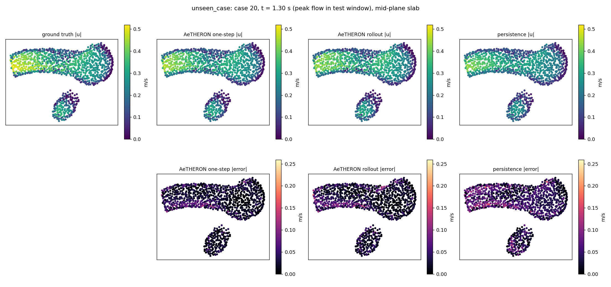
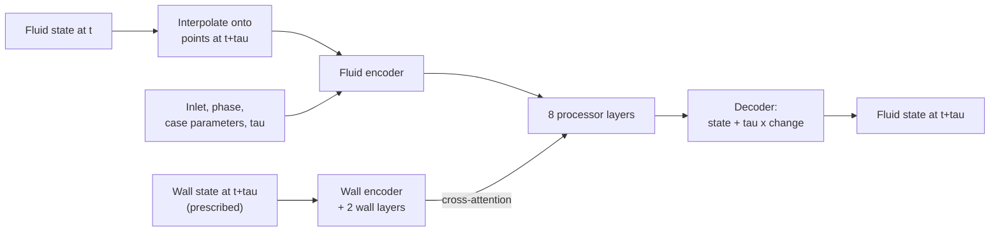
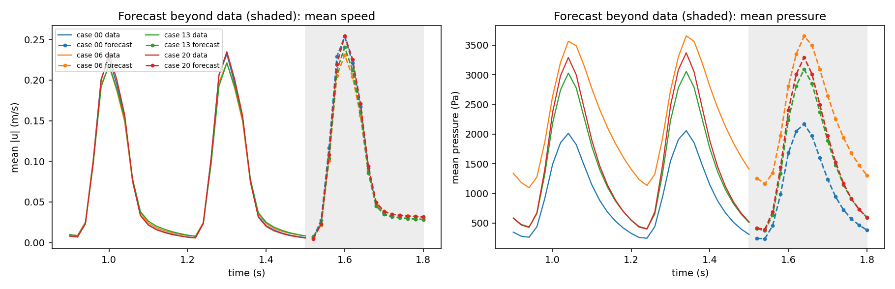

# Next-flow prediction for fluid-structure interaction (AeTHERON-style)

A PyTorch graph model that predicts the next velocity and pressure field in a flexible vessel with pulsing flow.
The method follows [AeTHERON (arXiv:2604.13369)](https://arxiv.org/abs/2604.13369), applied to a small 4-case
fluid-structure interaction (FSI) dataset.

> **Status: preliminary.** This is not a reproduction of the paper's results and not a validated flow solver.
> The paper studies a flapping caudal fin; this dataset is a different problem.

## Summary

| Question | Result |
|---|---|
| Does one-step velocity prediction work on an unseen case? | **Yes.** Error is 68% lower than "nothing changes" and 27% lower than averaging the other cases |
| Does it beat looking up the previous cycle? | **No, about a tie for velocity** on the unseen case; slightly worse on the later-time test |
| Do multi-step rollouts work? | **Not yet.** They beat a frozen flow but lose to simple lookups |
| Is the spatial pressure pattern accurate? | **No.** Error is about 2-6x that of the lookups |
| Is the forecast beyond the data validated? | **No.** There is no ground truth for that window |



*Held-out case 20 at peak flow (t = 1.30 s): flow speed (top) and speed error (bottom). The rollout columns are
shown for completeness; see the rollout results below.*

## Contents

- [Dataset](#dataset)
- [Method](#method)
- [Training](#training)
- [Evaluation](#evaluation)
- [Results](#results)
- [Forecast beyond the data](#forecast-beyond-the-data)
- [Differences from the paper](#differences-from-the-paper)
- [Limitations](#limitations)
- [Setup and usage](#setup-and-usage)
- [Repository layout](#repository-layout)
- [Next steps](#next-steps)
- [Reference](#reference)

## Dataset

The dataset is **not included** in this repository.

| Property | Value |
|---|---|
| Cases | 4 (00, 06, 13, 20) |
| Snapshots per case | 31, t = 0.90 to 1.50 s, every 0.02 s |
| Fluid points per snapshot | about 4000 (position, velocity, pressure) |
| Wall nodes | 4246 (position, displacement) |
| Inlet waveform | shared by all cases, period 0.30 s (15 snapshots), so the data spans two cycles |
| Peak speed | about 0.52 m/s |
| Case parameters | mu, alpha, s, and outlet values R1, R2, C1, C2, Z1, Z2 (which scale with s) |

- **Fluid points are not persistent.** The solver remeshes, so row *i* is a different location in each snapshot.
- **Wall rows are persistent.** All four cases also share the same undeformed wall geometry.
- **Inferred, not documented:** that this is a vessel. It follows from the geometry, the pulsatile inlet and the
  outlet parameters.

## Method



- **Remeshing:** the state at t is moved onto the fluid points at t+tau by inverse-distance interpolation
  (4 neighbours).
- **Fluid graph:** each point connects to its 8 nearest fluid points. Node fields are velocity (3) and pressure
  fluctuation p' (1). Position, wall distance, mean pressure and global inputs are added.
- **Wall graph:** each node connects to its 8 nearest wall nodes. It has 10 features: reference position (3),
  displacement at t+tau (3), wall velocity (3) and displacement magnitude (1).
- **Fluid-wall coupling:** sparse cross-attention from each fluid point to its 8 nearest wall nodes (Eqs. 11-13).
- **Fluid message passing:** kernel `kappa(e) = sum_r g_r(e) M_r`, applied to fluid neighbours (Eq. 8).
- **Time conditioning:** learned scale and shift from a sinusoidal embedding of tau (Eq. 15).
- **Decoder:** `x(t+tau) = x(t) + tau * psi(xi)` (Eq. 16). A separate head predicts mean pressure.
- **Global inputs (14):** inlet velocity at t and at 5 times leading up to t+tau, its slope, the cycle phase at t
  and t+tau, and (mu, alpha, s).

| Model setting | Value |
|---|---|
| Parameters | 494,949 |
| Latent / attention dimension | 64 / 64 (4 heads) |
| Processor / wall layers | 8 / 2 |
| Kernel width / time embedding | 4 / 16 |
| Lead times tau | 1, 2 and 3 snapshots |

## Training

| Setting | Value |
|---|---|
| Optimizer | Adam, learning rate 2e-3, halved every 10 epochs |
| Epochs / batch | 30 / 2 (gradient accumulation) |
| Loss | L1 on velocity + 0.5 x L1 on p' + 0.5 x L1 on mean pressure, all normalized |
| Regularization | Gaussian input noise 0.02, gradient clipping at 1.0 |
| Checkpoint | best validation loss; test data not used for selection |
| Seed | 0 (single run) |

| Split | Training data | Train / val pairs | Best epoch | Val velocity loss, first epoch to best | Copy-input val velocity loss |
|---|---|---|---|---|---|
| A `temporal` | all cases, t <= 1.32 s | 168 / 72 | 30 | 0.496 to 0.130 | 0.503 |
| B `unseen_case` | cases 00, 06, 13 | 222 / 39 | 29 | 0.513 to 0.098 | 0.509 |

Split A trained on CPU and split B on an Apple GPU (MPS).

## Evaluation

| Baseline | Meaning |
|---|---|
| Persistence | next flow = current flow |
| Previous cycle | flow 0.30 s earlier in the same case |
| Other cases | mean of cases 00, 06 and 13 at the same time (split B) |
| Frozen start | rollout baseline: the starting flow never changes |

All baselines are interpolated onto the target points. **MAE** is mean absolute error (m/s, or Pa for pressure).
**rel-L2** is the error norm divided by the true flow norm, averaged over snapshots. **p' MAE** is the error in the
spatial pressure pattern after removing the mean. Lower is better.

## Results

### A) Later times (36 test snapshots: 4 cases, t = 1.34 to 1.50 s)

| Prediction | Velocity MAE | Velocity rel-L2 | Pressure MAE | p' MAE |
|---|---|---|---|---|
| AeTHERON-style, one step | 0.0042 | 0.272 | **21.4** | 2.10 |
| Persistence | 0.0116 | 0.549 | 290.5 | 4.94 |
| Previous cycle | **0.0036** | **0.232** | 29.0 | **0.34** |
| AeTHERON-style, 9-step rollout | 0.0135 | 1.707 | 84.6 | 4.12 |
| Frozen start | 0.0835 | 11.35 | 1131 | 25.9 |

These test phases all appeared one cycle earlier in training, so this is not a strong generalization test.

### B) Unseen case 20 (30 test snapshots)

| Prediction | Velocity MAE | Velocity rel-L2 | Pressure MAE | p' MAE |
|---|---|---|---|---|
| AeTHERON-style, one step | **0.0055** | **0.210** | **60.1** | 2.20 |
| Persistence | 0.0170 | 0.524 | 391.0 | 7.27 |
| Other cases, same time | 0.0075 | 0.355 | 202.3 | **1.19** |
| AeTHERON-style, 30-step rollout | 0.0107 | 0.712 | 294.5 | 2.44 |
| Frozen start | 0.0340 | 0.732 | 1052 | 10.3 |

Only the 16 snapshots that have a previous cycle in the data:

| Prediction | Velocity MAE | Velocity rel-L2 | Pressure MAE | p' MAE |
|---|---|---|---|---|
| AeTHERON-style, one step | **0.0053** | **0.215** | 63.2 | 2.16 |
| Previous cycle | 0.0054 | 0.243 | **42.4** | **0.83** |

### What the results show

- **Positive:** on unseen case 20, one-step velocity MAE beats persistence in 29/30 snapshots and the other-cases mean
  in 26/30. On the later-time test it beats persistence in 36/36.
- **Neutral:** against the previous cycle on case 20, the model wins 8/16 snapshots by velocity MAE.
- **Negative:** rollouts lose to lookups that need no rollout (A: 0.0135 vs 0.0036; B: 0.0107 vs 0.0075).
  The split A rollout rel-L2 of 1.7 is worse than predicting zero flow.
- **Negative:** p' error is about 2-6x the lookups, so total pressure accuracy comes mainly from the mean level.

## Forecast beyond the data

The split A model was rolled out 15 steps, t = 1.52 to 1.80 s. **There is no ground truth.** Fluid points and wall
motion were borrowed from one cycle earlier, with an adjustment for wall drift, so this assumes the cycle repeats.



| Case | Mean speed at 1.52 s (m/s) | Peak mean speed, forecast vs previous cycle | Peak mean pressure (Pa), forecast vs previous cycle | Mean speed at 1.80 s vs one cycle earlier | rel-L2 difference from previous cycle |
|---|---|---|---|---|---|
| 00 | 0.0055 | 0.254 vs 0.232 | 2170 vs 2059 | 0.029 vs 0.006 | 1.16 |
| 06 | 0.0071 | 0.231 vs 0.221 | 3653 vs 3657 | 0.031 vs 0.008 | 1.02 |
| 13 | 0.0074 | 0.240 vs 0.221 | 3095 vs 3056 | 0.028 vs 0.008 | 0.92 |
| 20 | 0.0047 | 0.254 vs 0.235 | 3294 vs 3371 | 0.032 vs 0.006 | 1.35 |

Peak timing matches the repeating cycle (speed at 1.60 s, pressure at 1.64 s). Late in the cycle the forecast leaves
too much residual flow, and its spatial detail should not be trusted.

## Differences from the paper

| | Paper | Here |
|---|---|---|
| Problem | flapping caudal fin | flexible vessel with pulsing inflow |
| Reported training data | 1 case, 150 steps | 4 cases, 31 snapshots each |
| Latent dim / layers | 32 / 10 | 64 / 8 |
| Epochs | 200 | 30 |
| Neighbourhoods | fixed radius | nearest neighbours |
| Fluid points | not described as remeshed | change each snapshot, so interpolation is needed |
| Kernel | parameterized matrix kernel | low-rank matrix kernel, plus residual connections |
| Extra inputs | - | inlet waveform, cycle phase, case parameters |
| Extra output | - | mean-pressure head |
| Loss | 0.6 flow + 0.4 membrane | flow and pressure only; wall motion is an input |

Because the problem and data differ, errors here cannot be compared with the paper's reported MAE of 0.168.

## Limitations

- **Future geometry is an input.** The model gets the true future wall motion and fluid point positions. The paper also
  prescribes the future structure state. Wall motion tracks pressure, so this may explain part of the pressure accuracy.
- **Limited generalization evidence.** One held-out case; all cases share the undeformed geometry and inflow.
- **Single run.** One seed, so run-to-run variation is unknown.
- **Small preprocessing leak, not yet fixed.** Scaling of (mu, alpha, s) uses all four cases, including held-out case 20.
  No case 20 flow data was used to train split B.
- **Interpolation error** from remeshing is included in all scores.
- **Coarse data.** Point clouds are reduced to about 4000 points and are not suitable for solver-grade conclusions.
- **Rollout plots are incomplete.** The rollout panels in `error_vs_time.png` show only the frozen-start baseline;
  use the tables above.
- **Speed not measured** against a flow solver.

## Setup and usage

Tested with Python 3.14, torch 2.9.1, numpy 2.2.6, scipy 1.16.3 and matplotlib 3.10.8 on Apple silicon.

```bash
git clone https://github.com/srijapentyala/aetheron-fsi.git
cd aetheron-fsi
pip install numpy scipy torch matplotlib
```

Place `cases/`, `geometry/`, `shared/` and `subset_metadata.json` in the repository root. (`geometry/` is part of the
dataset but is not read by the code.)

```bash
# train (overwrites the checkpoints in outputs/)
python3 -m aetheron.train --split temporal --device cpu --epochs 30
python3 -m aetheron.train --split unseen_case --device mps --epochs 30   # or cpu

# evaluate with the trained checkpoints
python3 -m aetheron.evaluate --split temporal
python3 -m aetheron.evaluate --split unseen_case

# forecast one cycle beyond the data
python3 -m aetheron.forecast --model outputs/temporal/model.pt
```

Training took about 2.5 minutes per epoch per run on this machine, with both runs going at once. Load checkpoints
only from sources you trust: `evaluate.py` uses `torch.load(..., weights_only=False)`.

## Repository layout

```
aetheron/
  data.py        graphs, interpolation, normalization
  model.py       the graph model
  train.py       training and splits
  evaluate.py    metrics, baselines, figures
  forecast.py    rollout beyond the data
outputs/
  temporal/      split A: model, metrics, figures
  unseen_case/   split B: model, metrics, figures
  forecast/      forecast summary and figure
  train_*.log    training logs
```

Prediction and forecast arrays (`.npz`) are not included; `evaluate.py` and `forecast.py` regenerate them.

## Next steps

1. Train on multi-step rollouts.
2. Redraw the rollout plots with every baseline, and measure inference time.
3. Fix the parameter-scaling leak, then hold out each case in turn with several seeds.
4. Improve spatial pressure prediction.
5. Test how much accuracy depends on the prescribed future wall motion.

## Reference

Sushrut Kumar. *AeTHERON: Autoregressive Topology-aware Heterogeneous Graph Operator Network for Fluid-Structure
Interaction.* arXiv:2604.13369, 2026. This repository is an independent implementation.
